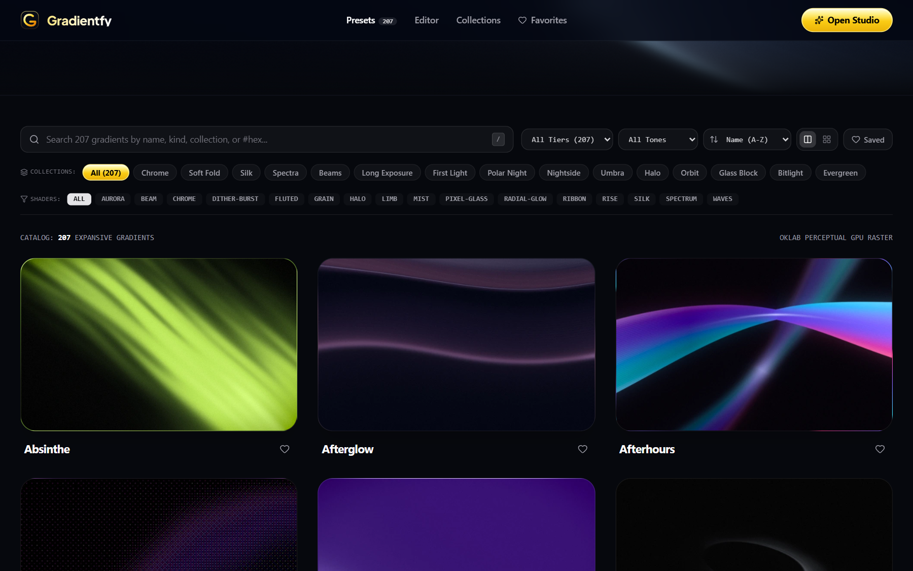
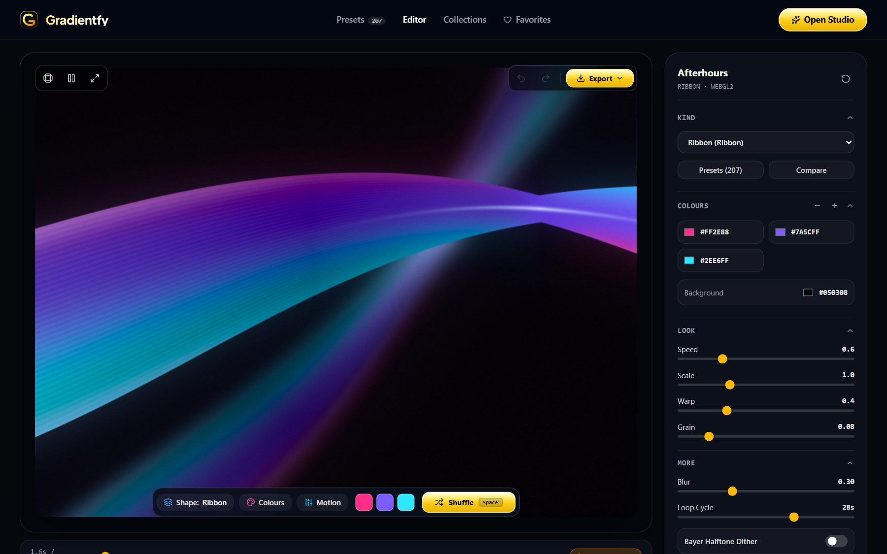
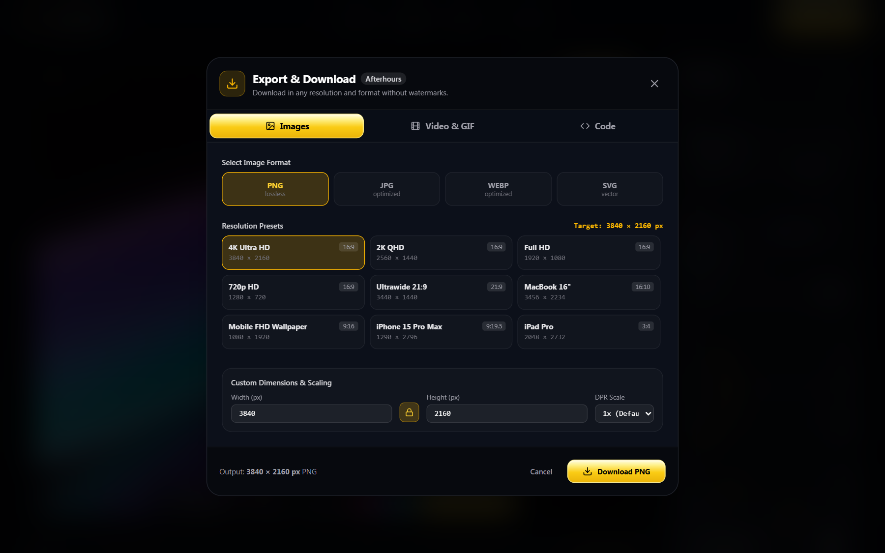
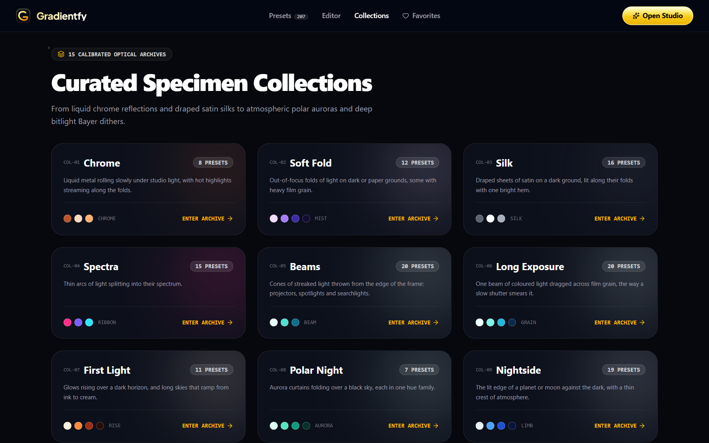
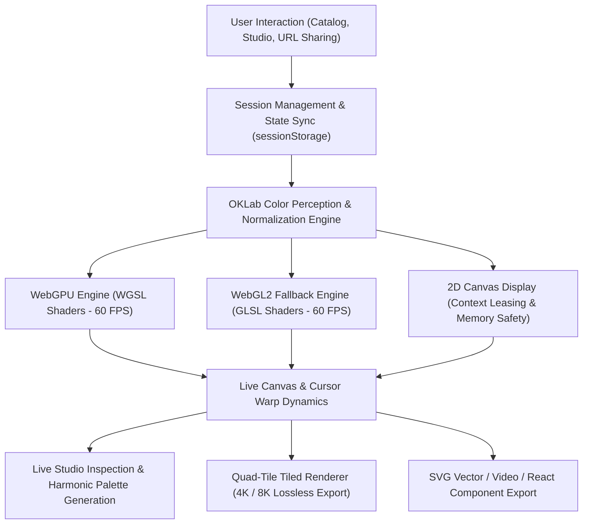

<div align="center">

# Gradientfy — 207 Live GPU Gradients, Interactive Studio & Exporter

<p align="center">
  <a href="README.tr.md">🇹🇷 Türkçe</a> • <b>🇺🇸 English</b>
</p>

<p align="center">
  <strong>Next-generation visual engine powered by WebGPU & WebGL2, featuring smooth OKLab color space interpolation, 22 parametric shaders, and 15 optical collections.</strong><br>
  <em>Live 60 FPS shaders, interactive studio editor, Cursor Warp dynamics, and lossless multi-format export up to 8K.</em>
</p>

<p align="center">
  <a href="LICENSE"></a>
  <a href="https://github.com/omerfys/Gradientfy/stargazers"></a>
  <a href="https://www.typescriptlang.org/"></a>
  <a href="https://react.dev/"></a>
  <a href="https://developer.mozilla.org/en-US/docs/Web/API/WebGPU_API"></a>
  <a href="https://tailwindcss.com/"></a>
  
  
  
</p>

<br>

> **Gradientfy** is an open-source, GPU-accelerated gradient ecosystem that breaks the boundaries of static CSS gradients in modern web and digital design. With 22 distinct mathematical and optical shader models, 207 calibrated presets, and a fully featured studio editor, it transforms backgrounds into living digital artworks and lets you export them to React, CSS, or 8K images/videos with a single click.

[Quick Start](#quick-start--installation) • [Features](#features) • [22 GPU Shader Models](#22-gpu-shader-models) • [Studio View](#studio-editor-studio-view) • [Export Options](#multi-resolution-and-format-export) • [Architecture](#architecture--how-it-works)

<br>

<div align="center">
  
  <p align="center"><em>▲ 207 calibrated gradients, 15 collection filters, quick search, and live GPU preview cards</em></p>
</div>

---

</div>

## Table of Contents

- [Project Vision](#project-vision)
- [Features](#features)
- [22 GPU Shader Models](#22-gpu-shader-models)
- [Studio Editor (Studio View)](#studio-editor-studio-view)
- [Multi-Resolution and Format Export](#multi-resolution-and-format-export)
- [15 Curated Collections Archive](#15-curated-collections-archive)
- [Architecture & How It Works](#architecture--how-it-works)
- [Quick Start & Installation](#quick-start--installation)
- [Keyboard Shortcuts](#keyboard-shortcuts)
- [Frequently Asked Questions (FAQ)](#frequently-asked-questions-faq)
- [License & Author](#license--author)

---

## Project Vision

Traditional web gradients are often limited to low-resolution static image files or basic CSS `linear-gradient` / `radial-gradient` declarations. This results in dull intermediate tones ("gray dead zone") in sRGB color space and zero dynamic motion.

**Gradientfy** fundamentally changes this paradigm:
1. **Perceptual OKLab Color Space:** All color transitions are calculated within OKLab color space tailored to human visual perception; preventing any muddiness, desaturation, or dullness.
2. **WebGPU & WebGL2 Hybrid Render Engine:** Executes fluid physics and wave equations at 60 FPS utilizing your browser's hardware acceleration.
3. **Pixel-Perfect Live Synchronization:** Preview cards transition seamlessly (zero-jump) from static $t=0$ snapshots into active live canvas streams on hover.
4. **Delivered as Code:** Export any gradient directly into shadcn-compatible React components, CSS animations, or 4K/8K lossless media for your projects.

---

## Features

- **207 Highly Calibrated Presets:**
  - Dark, light, monochrome, pastel, and neon color palettes.
  - Zero-latency smooth animation kickoff upon hovering over preview cards.
- **22 Mathematical Shader Models:**
  - Polar-inspired Auroras, delicate silk cloth folds (Silk), photonic light beams (Beam), retro Bayer half-tone dithering (Dither), and liquid chrome reflections.
- **Live Studio Editor:**
  - Add/remove color stops and generate harmonious palettes with a single click using color theory (Harmonic Palette).
  - Fine-tune speed, scale, warp, film grain, and blur settings.
  - Framing aspect ratios: 16:9, 9:16, 1:1, 3:1, and Full Screen.
  - Constrained and responsive **Cursor Warp** mouse dynamics.
  - Unlimited **Undo / Redo** history tracking.
  - Session state persistence retaining the selected gradient and modifications across browser refreshes (F5).
- **Multi-Resolution and Format Export:**
  - **Images:** 4K UHD, 2K QHD, Full HD, Ultrawide, MacBook 16", iPhone 15 Pro Max, and iPad Pro presets in PNG, JPG, WebP, and pure vector SVG.
  - **Animation & Video:** Seamless looping 60 FPS WebM and MP4 video output, animated GIF.
  - **Developer Code:** Standard CSS3 keyframe animations, JSX / TSX React component templates, and shareable URL links.

---

## 22 GPU Shader Models

At its core, Gradientfy incorporates 22 different WGSL/GLSL shader algorithms:

| Shader Type | Algorithm & Characteristics | Ideal Use Case |
| :--- | :--- | :--- |
| **Aurora** | Polar lights vertical folding and curtain wave dynamics | Atmospheric hero sections |
| **Beam** | High-energy conical beams radiating from corners | Accent areas, futuristic interfaces |
| **Chrome** | Liquid metal specular reflections and sharp highlights | Premium luxury brands, tech showcases |
| **Dither Field** | Classic retro Bayer matrix pixel half-tone dithering | Cyberpunk, nostalgic, and lofi designs |
| **Dither Burst** | Centrifugal circularly dispersing 8-bit dither particles | Interactive button backdrops, burst effects |
| **Fluted** | Optical refractions through fluted architectural glass | Minimalist architecture and luxury portfolios |
| **Grain** | Heavy analog 35mm film grain and soft blending | Organic, editorial, and artistic projects |
| **Halo** | Atmospheric ring refractions and soft corona glow | Soft ambient lighting, focal centerpieces |
| **Horizon** | Astronomical color horizons breaking across the edge | Scenery, calm entry screens, landscapes |
| **Limb** | Planetary atmospheric crescent edge against deep space | Space and deep dark themes |
| **Linear Flow** | Smooth single-axis color drift and diffusion | Clean SaaS landing pages |
| **Mesh** | Multi-node freeform deformation mesh gradient | Modern web apps, dashboard backgrounds |
| **Mist** | Dense fog layers with low-contrast volumetric lighting | Mysterious, subtle backdrops |
| **Pixel Glass** | Mosaic glass refractions causing geometric pixelation | Digital abstract art |
| **Radial Glow** | Intense radial light scattering and energy points | Button glow highlights, callout focal points |
| **Ribbon** | Dual-surface silky ribbon waves undulating in 3D space | Fluid and modern creative portfolios |
| **Rise** | Upward thermal heat gradient lifting from the baseplate | Energetic and modern product showcases |
| **Silk** | Satin fabric folds cascading over dark backgrounds | Fashion, lifestyle, and premium landing pages |
| **Smear** | Long-exposure brush streaks and optical color shifts | Bold, dynamic design languages |
| **Spectrum** | Prismatic light dispersion and rainbow wavelengths | Creative design studios |
| **Swirl** | Centrifugal fluid vortex dynamics | Hypnotic, eye-catching visual showcases |
| **Void** | Deep cosmic abyss and gravitational core absorption | Minimalist dark mode themes |

---

## Studio Editor (Studio View)

<div align="center">
  
  <p align="center"><em>▲ Studio Editor: Expansive live canvas, real-time timeline scrubber, precision control panel, and ergonomic toolbar</em></p>
</div>

1. **Canvas Controls:** Dynamically adjust full-screen and framing aspect ratios (16:9, 9:16, 1:1, 3:1) from the top-left toolbar.
2. **Harmonic Color Generator (Colours):** Uses color theory to produce randomized yet mathematically harmonious (*analogous, triadic, complementary, split-complementary*) palettes.
3. **Cursor Warp:** Organically distorts the gradient based on mouse position strictly when hovering over the canvas; smoothly dampens back to center when the cursor leaves.
4. **Timeline Scrubber:** Pause the animation and scrub through frames second-by-second across the timeline.

---

## Multi-Resolution and Format Export

<div align="center">
  
  <p align="center"><em>▲ Export Modal: Multi-device presets including 4K Ultra HD and lossless format selection</em></p>
</div>

* **Tile-Based 8K WebGL Renderer:** Slices massive images such as 3840×2160 (4K) or 7680×4320 (8K) into quad-tile segments that hardware GPUs might otherwise fail to render in a single pass, avoiding out-of-memory errors.
* **Vector SVG:** Resolution-independent, infinitely scalable, and web-standards compliant SVG export.
* **CSS & React Code Export:** One-click copyable and clean code ready to paste into your codebase.

---

## 15 Curated Collections Archive

<div align="center">
  
  <p align="center"><em>▲ 15 optical collections: Chrome, Soft Fold, Silk, Spectra, Beams, Long Exposure, Polar Night, and more</em></p>
</div>

Gradientfy offers 15 conceptual collections for designers seeking thematic consistency:
`Chrome` • `Soft Fold` • `Silk` • `Spectra` • `Beams` • `Long Exposure` • `First Light` • `Polar Night` • `Nightside` • `Umbra` • `Halo` • `Orbit` • `Glass Block` • `Bitlight` • `Evergreen`.

---

## Architecture & How It Works



---

## Quick Start & Installation

### Prerequisites
- **Node.js:** v18+ (Recommended: v20 or v22 LTS)
- **Browser:** Modern browser with WebGL2 or WebGPU support (Chrome, Edge, Brave, Firefox, Safari)

### 1. Clone the Repository
```bash
git clone https://github.com/omerfys/Gradientfy.git
cd Gradientfy
```

### 2. Install Dependencies
```bash
npm install
```

### 3. Start Development Server
```bash
npm run dev
```
The application will run locally at `http://localhost:3030`.

### 4. Production Build
```bash
npm run build
npm run preview
```

---

## Keyboard Shortcuts

| Key | Action |
| :--- | :--- |
| <kbd>Space</kbd> | Instant random color and seed shuffle in Studio editor |
| <kbd>Ctrl</kbd> + <kbd>Z</kbd> | Undo last parameter or color modification |
| <kbd>Ctrl</kbd> + <kbd>Y</kbd> | Redo modification |

---

## Frequently Asked Questions (FAQ)

<details>
<summary><strong>1. Does it work on devices without WebGPU support?</strong></summary>
Yes. Gradientfy features a dual-layer shader architecture. If WebGPU is unavailable on your system, the engine automatically falls back to WebGL2 mode. Both modes deliver the same high resolution and fluid performance.
</details>

<details>
<summary><strong>2. Will my selected gradient be lost if I refresh the page (F5)?</strong></summary>
No. Gradientfy continuously persists session state, your selected gradient, and all color/geometry modifications. When you refresh with F5, you pick up right where you left off.
</details>

<details>
<summary><strong>3. Are downloaded media files watermarked?</strong></summary>
Absolutely not. All PNG, WebP, SVG, and video files exported from Gradientfy are 100% clean and watermark-free.
</details>

---

## License & Author

This project is open-source under the [MIT License](LICENSE).

Developer: **[@omerfys](https://github.com/omerfys)**  
GitHub Repository: [https://github.com/omerfys/Gradientfy](https://github.com/omerfys/Gradientfy)

**If you like this project, don't forget to star it on GitHub!**
