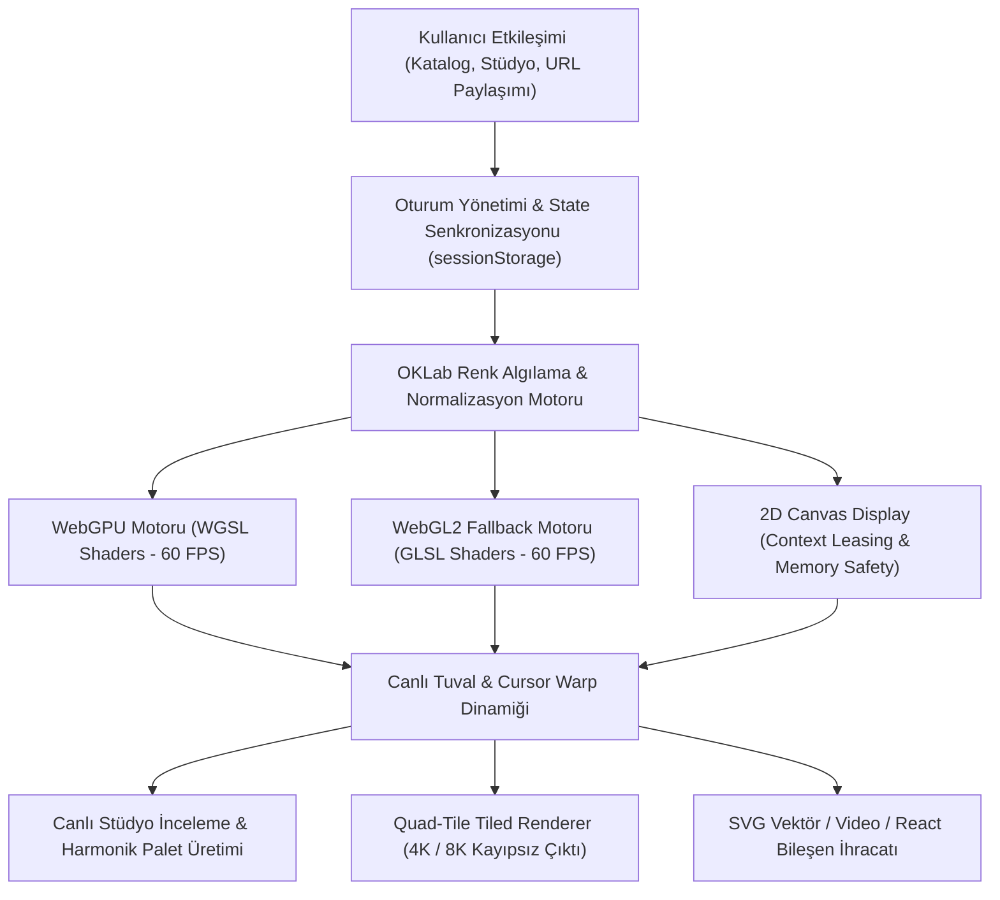

<div align="center">

# Gradientfy — 207 Live GPU Gradients, Interactive Studio & Exporter

<p align="center">
  <strong>WebGPU & WebGL2 destekli, OKLab renk alanında pürüzsüz enterpolasyonlu, 22 parametrik gölgelendirici ve 15 optik koleksiyondan oluşan yeni nesil görsel motoru.</strong><br>
  <em>Canlı 60 FPS gölgelendiriciler, interaktif stüdyo editörü, Cursor Warp dinamikleri ve 8K'ya varan kayıpsız çoklu format dışa aktarım desteği.</em>
</p>

<p align="center">
  <a href="LICENSE"></a>
  <a href="https://github.com/omerfys/Gradientfy/stargazers"></a>
  <a href="https://www.typescriptlang.org/"></a>
  <a href="https://react.dev/"></a>
  <a href="https://developer.mozilla.org/en-US/docs/Web/API/WebGPU_API"></a>
  <a href="https://tailwindcss.com/"></a>
  
  
  
</p>

<br>

> **Gradientfy**, modern web ve dijital tasarım dünyasında statik CSS gradyanlarının sınırlarını yıkan açık kaynaklı, GPU hızlandırmalı bir gradyan ekosistemidir. 22 farklı matematiksel ve optik gölgelendirici modeli, 207 kalibre edilmiş preset ve tam donanımlı stüdyo editörüyle; arka planları canlı birer dijital sanat eserine dönüştürür ve tek tıkla React, CSS veya 8K görsel/video olarak dışa aktarmanızı sağlar.

[Hızlı Başlangıç](#hızlı-başlangıç--kurulum) • [Özellikler](#özellikler-features) • [22 GPU Gölgelendirici](#22-gpu-gölgelendirici-modeli) • [Stüdyo Editörü](#stüdyo-editörü-studio-view) • [Dışa Aktarım (Export)](#çoklu-çözünürlük-ve-format-dışa-aktarımı) • [English Overview](#english-overview)

<br>

<div align="center">
  
  <p align="center"><em>▲ 207 kalibre edilmiş gradyan, 15 koleksiyon filtresi, hızlı arama ve canlı GPU önizleme kartları</em></p>
</div>

---

</div>

## İçindekiler (Table of Contents)

- [Proje Vizyonu](#proje-vizyonu)
- [Özellikler (Features)](#özellikler-features)
- [22 GPU Gölgelendirici Modeli](#22-gpu-gölgelendirici-modeli)
- [Stüdyo Editörü (Studio View)](#stüdyo-editörü-studio-view)
- [Çoklu Çözünürlük ve Format Dışa Aktarımı](#çoklu-çözünürlük-ve-format-dışa-aktarımı)
- [15 Küratörlü Koleksiyon Arşivi](#15-küratörlü-koleksiyon-arşivi)
- [Mimari & Çalışma Prensibi](#mimari--çalışma-prensibi)
- [Hızlı Başlangıç & Kurulum](#hızlı-başlangıç--kurulum)
- [Klavye Kısayolları](#klavye-kısayolları)
- [Sıkça Sorulan Sorular (FAQ)](#sıkça-sorulan-sorular-faq)
- [English Overview](#english-overview)
- [Lisans & Yazar](#lisans--yazar)

---

## Proje Vizyonu

Geleneksel web sitelerindeki gradyanlar ya düşük çözünürlüklü statik görsellerden ibarettir ya da CSS `linear-gradient` / `radial-gradient` komutlarıyla sınırlıdır. Bu durum sRGB renk uzayında soluk ara tonlara ("gri ölü bölge") ve sıfır hareket dinamiğine yol açar.

**Gradientfy**, bu paradigmayı kökten değiştirir:
1. **Perceptual OKLab Renk Uzayı:** Tüm renk geçişleri insan gözünün algısına göre tasarlanan OKLab uzayında hesaplanır; hiçbir solma veya çamurlaşma yaşanmaz.
2. **WebGPU & WebGL2 Hibrit Render Motoru:** Tarayıcınızın donanım hızlandırmasını kullanarak 60 FPS hızında akışkan fizik ve dalga formülleri çalıştırır.
3. **Pikseli Pikseline Canlı Senkronizasyon:** Önizleme kartları durağan $t=0$ anından live canvas akışına sıçramasız (zero-jump) geçer.
4. **Kod Olarak Teslimat:** Beğendiğiniz herhangi bir gradyanı doğrudan shadcn uyumlu React bileşeni, CSS animasyonu veya 4K/8K kayıpsız medya olarak projelerinize dahil edebilirsiniz.

---

## Özellikler (Features)

- **207 Yüksek Kalibreli Önayar (Presets):**
  - Karanlık, aydınlık, monokrom, pastel ve neon ton seçenekleri.
  - Canlı kart üzerine gelindiğinde (hover) sıfır gecikmeli akıcı animasyon başlatma.
- **22 Matematiksel Shader Modeli:**
  - Kutuplardan ilham alan Auroralar, ipek kumaş kırışıklıkları (Silk), foton ışık huzmeleri (Beam), retro Bayer tramlamaları (Dither) ve sıvı krom yansımaları.
- **Canlı Stüdyo Editörü:**
  - Renk durakları (color stops) ekleme/çıkarma ve renk teorisine dayalı (Harmonic Palette) tek tıkla palet oluşturucu.
  - Hız, ölçek, bükülme (warp), gren (film grain) ve blur ayarları.
  - 16:9, 9:16, 1:1, 3:1 ve Full ekran en-boy oranı çerçeveleme seçenekleri.
  - Sınırlı ve hassas **Cursor Warp** fare etkileşimi.
  - Sınırsız **Geri Al / İleri Al (Undo / Redo)** geçmiş takibi.
  - Sayfa yenilendiğinde (F5) son seçilen gradyanı ve yapılan değişiklikleri hafızada tutan oturum yönetimi.
- **Çoklu Çözünürlük ve Format Dışa Aktarımı:**
  - **Görsel:** 4K UHD, 2K QHD, Full HD, Ultrawide, MacBook 16", iPhone 15 Pro Max ve iPad Pro boyutlarında PNG, JPG, WebP ve saf vektörel SVG.
  - **Animasyon & Video:** Döngüsel 60 FPS WebM ve MP4 video çıktısı, hareketli GIF.
  - **Geliştirici Kodları:** Standart CSS3 animasyon kodu, JSX / TSX React bileşen şablonu, URL paylaşım bağlantısı.

---

## 22 GPU Gölgelendirici Modeli

Gradientfy çekirdeğinde 22 farklı WGSL/GLSL gölgelendirici algoritması barındırır:

| Shader Türü | Algoritma ve Karakteristik | İdeal Kullanım Alanı |
| :--- | :--- | :--- |
| **Aurora** | Kutup ışıkları dikey katlanma ve perdeleme dalgaları | Atmosferik kahraman (hero) bölümleri |
| **Beam** | Köşeden fırlayan yüksek enerjili konik ışık huzmeleri | Vurgu alanları, fütüristik arayüzler |
| **Chrome** | Sıvı metal yansımaları ve keskin speküler parlaklıklar | Premium lüks markalar, teknoloji sayfaları |
| **Dither Field** | Klasik retro Bayer matrisi piksel yarı-ton dither tramı | Cyberpunk, nostaljik ve lofi tasarımlar |
| **Dither Burst** | Merkezkaç dairesel dağılan 8-bit dither parçacıkları | Etkileşimli buton arkaları, patlama efektleri |
| **Fluted** | Yivli mimari cam arkasından süzülen optik kırılmalar | Minimalist mimari ve lüks portfolyolar |
| **Grain** | Ağır analog 35mm film greni ve yumuşak mikser | Organik, editoryal ve sanatsal projeler |
| **Halo** | Atmosferik halka kırılmaları ve yumuşak korona ışıması | Yumuşak aydınlatmalar, odak merkezleri |
| **Horizon** | Ufuk çizgisi üzerine doğan astronomik renk geçişleri | Manzara ve dingin karşılama ekranları |
| **Limb** | Gezegen atmosferinin karanlık uzay sınırındaki yay çizgisi | Uzay ve derin karanlık temalar |
| **Linear Flow** | Yumuşak tek eksenli akış ve renk difüzyonu | Temiz SaaS açılış sayfaları |
| **Mesh** | Çok düğümlü ve serbest deformasyonlu mesh gradyan | Modern web uygulamaları, dashboard arka planları |
| **Mist** | Yoğun sis katmanları ve düşük kontrastlı hacimsel ışık | Gizemli ve hafif arka planlar |
| **Pixel Glass** | Mozaik cam arkasından geçen optik piksellenme | Dijital soyut sanat |
| **Radial Glow** | Güçlü radyal ışık saçılımı ve enerji noktaları | Buton parlamaları, dikkat çekici alanlar |
| **Ribbon** | 3D uzayda süzülen çift yüzeyli ipeksi şerit dalgaları | Akışkan ve modern yaratıcı portfolyolar |
| **Rise** | Taban plakasından yükselen termal sıcaklık gradyanı | Enerjik ve modern ürün tanıtımları |
| **Silk** | Koyu zemin üzerine dökülen saten kumaş katlanmaları | Moda, lifestyle ve premium landing pageler |
| **Smear** | Uzun pozlama fırça darbesi ve optik renk kayması | Dinamik ve cesur tasarım dilleri |
| **Spectrum** | Prizmatik ışık kırılması ve gökkuşağı dalgaboyları | Yaratıcı tasarım stüdyoları |
| **Swirl** | Merkezkaç akışkan girdap ve sıvı dinamiği | Hipnotik ve dikkat çekici görsel şovlar |
| **Void** | Derin kozmik boşluk ve çekim merkezi emilimi | Minimalist koyu mod temalar |

---

## Stüdyo Editörü (Studio View)

<div align="center">
  
  <p align="center"><em>▲ Stüdyo Editörü: Geniş canlı tuval, anlık zaman çizelgesi, hassas denetim paneli ve ergonomik alt bar</em></p>
</div>

1. **Tuval Kontrolleri:** Üst sol kısımdan tam ekran ve en-boy oranlarını (16:9, 9:16, 1:1, 3:1) dinamik olarak değiştirebilirsiniz.
2. **Harmonik Renk Üreticisi (Colours):** Renk teorisini kullanarak rastgele ama birbiriyle daima uyumlu (*analogous, triadic, complementary, split-complementary*) paletler üretir.
3. **Cursor Warp:** Sadece gradient tuvali üzerindeyken farenin konumuna göre gradyanı organik bir şekilde büker; tuval dışına çıkıldığında merkez konuma yumuşakça sönümlenir.
4. **Zaman Kontrolü:** Animasyonu duraklatabilir, zaman çizelgesi üzerinde saniyelik kare taraması yapabilirsiniz.

---

## Çoklu Çözünürlük ve Format Dışa Aktarımı

<div align="center">
  
  <p align="center"><em>▲ Dışa Aktarım Modalı: 4K Ultra HD dahil çoklu cihaz profilleri ve kayıpsız format seçimi</em></p>
</div>

* **Tile-Based 8K WebGL Renderer:** GPU donanımınızın tek seferde render edemeyeceği 3840×2160 (4K) veya 7680×4320 (8K) boyutlarındaki görselleri quad-tile tekniğiyle parçalara bölerek sıfır bellek hatasıyla kusursuz oluşturur.
* **Vektörel SVG:** Çözünürlükten bağımsız, sonsuz ölçeklenebilir ve Web standartlarına uygun SVG çıktısı.
* **CSS & React Kod Çıktısı:** Tek tıkla kopyalanabilir ve projenize yapıştırılabilir temiz kod.

---

## 15 Küratörlü Koleksiyon Arşivi

<div align="center">
  
  <p align="center"><em>▲ 15 optik koleksiyon: Chrome, Soft Fold, Silk, Spectra, Beams, Long Exposure, Polar Night ve daha fazlası</em></p>
</div>

Gradientfy, tematik uyumluluk arayan tasarımcılar için 15 farklı konsept koleksiyonu sunar:
`Chrome` • `Soft Fold` • `Silk` • `Spectra` • `Beams` • `Long Exposure` • `First Light` • `Polar Night` • `Nightside` • `Umbra` • `Halo` • `Orbit` • `Glass Block` • `Bitlight` • `Evergreen`.

---

## Mimari & Çalışma Prensibi



---

## Hızlı Başlangıç & Kurulum

### Gereksinimler
- **Node.js:** v18+ (Önerilen: v20 veya v22 LTS)
- **Tarayıcı:** WebGL2 veya WebGPU destekli modern bir tarayıcı (Chrome, Edge, Brave, Firefox, Safari)

### 1. Depoyu Klonlayın
```bash
git clone https://github.com/omerfys/Gradientfy.git
cd Gradientfy
```

### 2. Bağımlılıkları Yükleyin
```bash
npm install
```

### 3. Geliştirme Sunucusunu Başlatın
```bash
npm run dev
```
Uygulama yerel olarak `http://localhost:3030` adresinde çalışacaktır.

### 4. Üretim Sürümü (Build)
```bash
npm run build
npm run preview
```

---

## Klavye Kısayolları

| Tuş | Eylem |
| :--- | :--- |
| <kbd>Space</kbd> | Stüdyo editöründe anlık rastgele renk ve tohum karıştırma (Shuffle) |
| <kbd>Ctrl</kbd> + <kbd>Z</kbd> | Son parametre veya renk değişikliğini geri al (Undo) |
| <kbd>Ctrl</kbd> + <kbd>Y</kbd> | İleri al (Redo) |

---

## Sıkça Sorulan Sorular (FAQ)

<details>
<summary><strong>1. WebGPU desteklemeyen cihazlarda çalışır mı?</strong></summary>
Evet. Gradientfy çift katmanlı bir gölgelendirici mimarisine sahiptir. Sisteminizde WebGPU mevcut değilse motor otomatik olarak WebGL2 moduna geçer. Her iki mod da aynı yüksek çözünürlüğü ve akıcılığı sunar.
</details>

<details>
<summary><strong>2. Sayfayı yenilediğimde (F5) seçtiğim gradyan kaybolur mu?</strong></summary>
Hayır. Gradientfy tüm oturum durumunu, seçtiğiniz gradyanı ve üzerinde yaptığınız renk/şekil değişikliklerini anlık olarak kaydeder. F5 attığınızda en son düzenlediğiniz gradyanla kaldığınız yerden devam edersiniz.
</details>

<details>
<summary><strong>3. İndirilen görsellerde filigran (watermark) var mı?</strong></summary>
Kesinlikle hayır. Gradientfy üzerinden dışa aktarılan tüm PNG, WebP, SVG ve video dosyaları %100 temiz ve filigransızdır.
</details>

---

## English Overview

**Gradientfy** is an open-source, next-generation GPU gradient engine and interactive studio built with WebGPU, WebGL2, React 19, and TailwindCSS v4. Featuring 22 mathematical shader models, 207 precision presets, and OKLab color-space interpolation, it turns mundane linear gradients into living, interactive digital artworks.

### Key Highlights:
- **Perceptual OKLab Color Space:** Eliminates muddy, desaturated gray dead zones commonly found in traditional sRGB transitions.
- **22 Mathematical Shader Engines:** Aurora ribbons, chromatic liquid metal, retro Bayer dithering, optical glass refractions, and cosmic nebulas.
- **Precision Studio Editor:** Real-time color tuning, harmonic palette generator, scoped cursor warp physics, and unlimited undo/redo.
- **Quad-Tile 8K Export:** Generates crystal-clear 4K and 8K wallpapers, vector SVGs, 60 FPS WebM/MP4 loops, and production-ready React components with zero watermarks.

---

## Lisans & Yazar

Bu proje [MIT Lisansı](LICENSE) altında açık kaynak olarak sunulmuştur.

Geliştirici: **[@omerfys](https://github.com/omerfys)**  
GitHub Deposu: [https://github.com/omerfys/Gradientfy](https://github.com/omerfys/Gradientfy)

**Projeyi beğendiyseniz GitHub üzerinden yıldız vermeyi unutmayın!**
